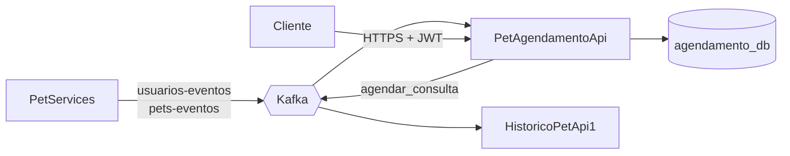

# PetAgendamentoApi — Agendamento de consultas

API de agendamento de consultas veterinárias. Faz parte de um sistema de **3 microsserviços** que conversam por eventos no **Kafka**.

| Serviço | Responsabilidade |
|---|---|
| [PetServices](https://github.com/carolinebrunheti/PetServices) | Login (emite o JWT), cadastros e eventos de cadastro |
| **PetAgendamentoApi** (este) | Agendamento de consultas |
| [HistoricoPetApi1](https://github.com/carolinebrunheti/HistoricoPetApi1) | Histórico de consultas |
| [PetServicesK8s](https://github.com/carolinebrunheti/PetServicesK8s) | Manifests Kubernetes, CI/CD e testes de carga (k6) |

## Arquitetura



- **Consome** `usuarios-eventos` e `pets-eventos` e mantém uma cópia local de tutores, veterinários e pets. Assim, para agendar, não precisa chamar o PetServices: continua funcionando mesmo se ele estiver fora do ar.
- **Publica** em `agendar_consulta` cada consulta criada, remarcada ou cancelada, que o Historico consome.
- **Não faz login**: valida localmente o JWT emitido pelo PetServices (mesmo segredo HS256).

## Tecnologias

Java 17 · Spring Boot 4 · Spring Security (OAuth2 Resource Server, JWT) · Spring Data JPA · PostgreSQL 17 · Flyway · Apache Kafka 4 · JUnit 5 · Mockito · Testcontainers · Docker · GitHub Actions

## Endpoints

| Rota | Método | Quem pode |
|---|---|---|
| `/agendarConsulta` | POST | Admin, atendente |
| `/agendarConsulta` | GET | Qualquer usuário logado (o tutor só vê as próprias consultas) |
| `/agendarConsulta/{id}` | GET | Qualquer usuário logado (tutor: só se a consulta for dele) |
| `/agendarConsulta/{id}` | PUT | Admin, atendente (remarcar) |
| `/agendarConsulta/{id}/cancelar` | PATCH | Admin, atendente, veterinário |
| `/actuator/health` | GET | Público (usado pelo Kubernetes) |

Regras de negócio: o tutor, o pet e o veterinário precisam existir e estar ativos; o pet precisa ser do tutor; o veterinário não pode ter outra consulta no mesmo horário (409); a data precisa ser futura. A listagem é paginada (`?page=0&size=10`, no máximo 50).

## Decisões de projeto

- **Dead Letter Topic (DLT).** Uma mensagem que não dá para processar é tentada mais 3 vezes (2 s entre elas) e depois vai para `<tópico>-dlt` com o conteúdo original e um log de erro, sem travar as mensagens seguintes. JSON inválido vai direto para a DLT.
- **Idempotência e ordem.** O Kafka entrega "pelo menos uma vez": um evento pode chegar repetido ou atrasado. Cada cadastro guarda quando foi atualizado (`atualizado_em`), e o consumidor **ignora eventos mais antigos** que o último aplicado. Um teste de integração mostrou que, sem isso, um evento antigo reentregue reativava um tutor já removido.
- **Falha rápida.** Com o Postgres fora, responde **503 com `Retry-After`** em ~3 s; com o Kafka fora, o envio desiste em 5 s em vez de 60 s.
- **Proteção contra IDOR.** O `id` do tutor vem de dentro do token (não da URL), então um tutor não vê a consulta de outro trocando o número na URL.

## Testes

**86 testes**, rodando no GitHub Actions a cada push e pull request:

- **Unitários e de controller** (Mockito, MockMvc).
- **Integração com Testcontainers** (Postgres e Kafka reais): eventos de cadastro viram tutor/pet no banco; o `POST` grava a consulta e publica o evento no Kafka; conflito de horário dá 409.
- **Mensagens problemáticas**: JSON inválido vai para a DLT com o conteúdo original; evento antigo reentregue não reativa cadastro removido.
- **Segurança**: token expirado ou sem as claims esperadas; papéis sem permissão; tutor tentando ver ou cancelar a consulta de outro.

```bash
./mvnw test        # precisa do Docker rodando (Testcontainers)
```

## Como rodar localmente

Pré-requisitos: Java 17, Docker e a infraestrutura do [PetServices](https://github.com/carolinebrunheti/PetServices) rodando (`docker compose up -d` lá sobe o Postgres e o Kafka).

```bash
# 1. criar o banco deste serviço no Postgres do PetServices (uma vez)
docker exec -it petservices-db psql -U postgres -c "CREATE DATABASE agendamento_db"

# 2. variáveis de ambiente: o mesmo DB_PASSWORD e JWT_SECRET do PetServices
cp .env.example .env

# 3. a API
./mvnw spring-boot:run
```

A API sobe em `http://localhost:8082`. Faça login no PetServices (`POST localhost:8081/auth/login`) e use o token aqui. Com o PetServices rodando, os tutores, pets e veterinários chegam sozinhos pelo Kafka.
